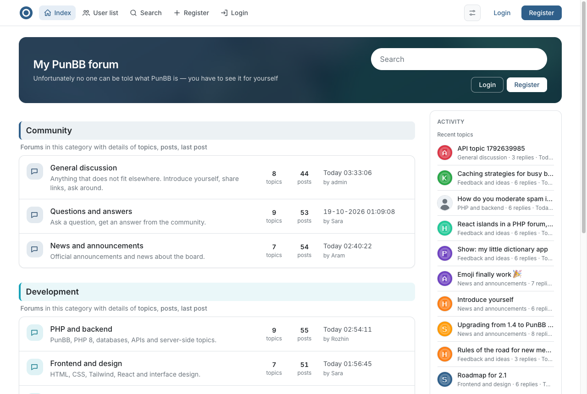
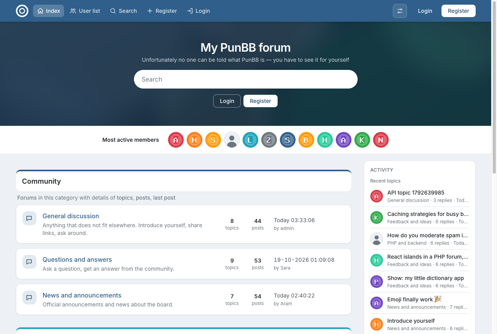
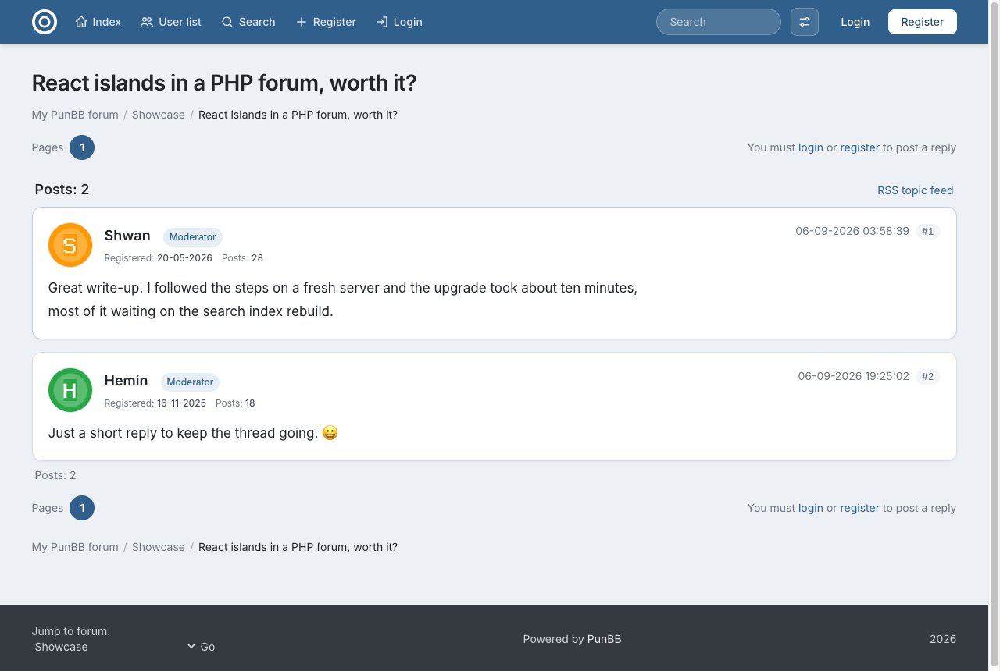
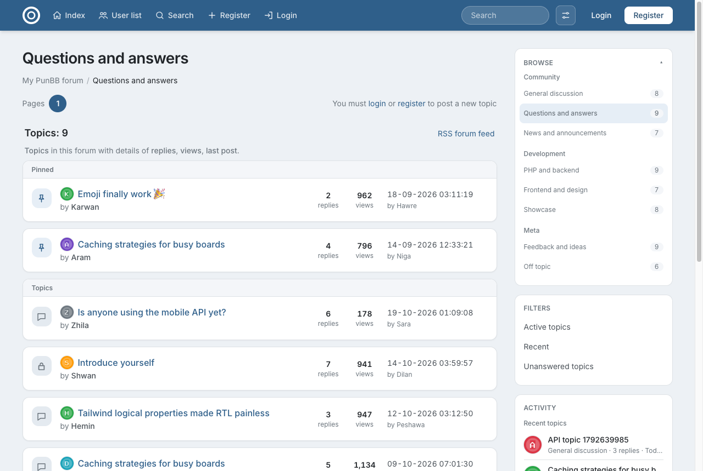
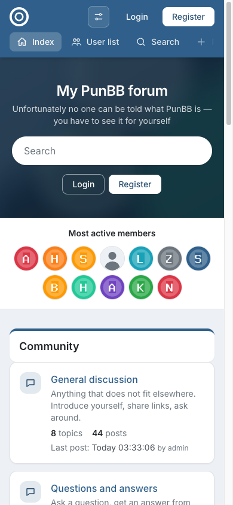
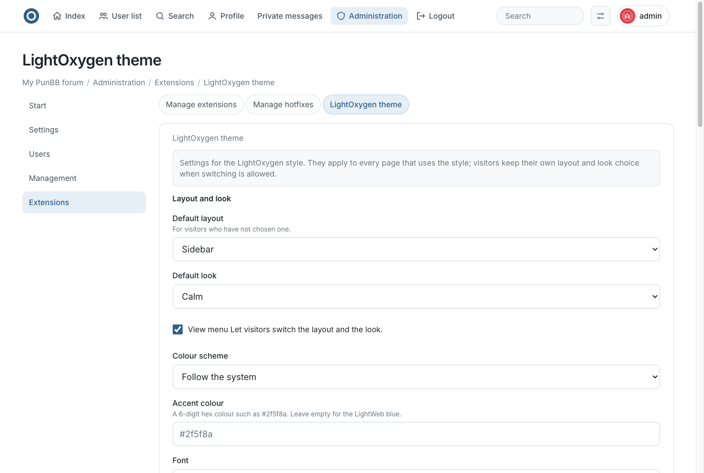

# PunBB 2

PunBB is a fast, lightweight discussion board written in PHP. Version 2 is based on PunBB 1.4, brings the codebase to PHP 8.3+ and MySQL 8, adds a JSON API, and ships LightOxygen, a modern responsive theme with full right-to-left support, as the default style. English is the default language; Kurdish (Sorani) is included.

## Screenshots


*Index, Calm look: the hero with the theme's default background, forum categories and the activity panel.*


*Index, Meko look: a full-width hero band and the row of most active members.*


*A topic: posts as cards with avatars and group badges.*


*A forum: pinned topics grouped above the rest, starter avatars, and the Browse and Filters sidebar.*



*On a phone (390px): the View button stays in the header, so layout and look can be switched anywhere.*


*The LightOxygen theme settings in Administration, from the bundled settings extension.*

## What's new in 2.0

- **Modern platform.** Runs on PHP 8.3, 8.4 and 8.5; works with MySQL 8 and 9 (reserved words, utf8mb4, emoji in posts); the PostgreSQL layer is fixed for PHP 8.1+ and verified on PostgreSQL 17. The legacy `mysql` extension and SQLite 2 layers are gone; configs that use `mysql` or `mysql_innodb` fall back to mysqli automatically.
- **JSON API.** A read and write API for boards, forums, topics, posts and users under `api/`. See [`api/README.md`](api/README.md).
- **LightOxygen theme**, the default style for new installs:
  - two layouts, sidebar (categories, filters, activity and statistics beside the content) and wide (one column), two looks, Calm and Meko, and a colour scheme (follow the system, light or dark); visitors switch all three from the View menu in the header, on desktop and on phones, and members keep their choice in their profile;
  - search suggestions that match the word being typed as a prefix;
  - styles for the bundled `pun_pm` (private messages) and `pun_attachment` extensions;
  - an index hero with the board title, tagline, a large search and sign-in, over a default background image or one the admin uploads;
  - pinned topics grouped above the rest, avatars for posters, topic starters, the activity panel and the most active members;
  - small React islands (search, quick reply, the live activity panel) on top of server-rendered pages that work without JavaScript;
  - full right-to-left support for Kurdish, built with logical CSS properties.
- **Settings extension.** `lightoxygen_settings` adds an admin page for the theme: default layout and look, colours, font, hero, logo, favicon and more.
- **English by default.** English is the default language for new installs; Kurdish is included and can be chosen per user or as the board default.
- Core fixes: a mysqli double free, the extension version check, PostgreSQL deprecations and the JSON error branches.

See `ChangeLog` for the full list.

## Requirements

- PHP 8.3 or newer with the `mbstring` extension.
- One of:
  - MySQL 5.7 or newer (MySQL 8 and 9 supported) with the `mysqli` extension.
  - PostgreSQL with the `pgsql` extension.
  - SQLite 3 with the `sqlite3` extension.
- Any web server that can run PHP (Apache, Nginx, Caddy, or the PHP built-in server for local testing).

## Installation

1. Clone the repository or download and extract the archive into your web root:

   ```
   git clone https://github.com/thejano/punbb.git punbb
   ```

2. Make sure the web server can write to `cache/`, `img/avatars/`, `img/lightoxygen/` and `extensions/`.

3. Create an empty database (for MySQL, use the `utf8mb4` character set).

4. Open `admin/install.php` in your browser and follow the steps. The installer writes `config.php` for you.

5. Delete or protect `admin/install.php` afterwards.

New installations use the LightOxygen style by default. It has a sidebar layout and a wide layout, two looks, Calm and Meko, and a light and a dark colour scheme, and visitors can switch between them from the View menu in the header at any screen width. Guests keep their choice in a cookie; with the settings extension installed, members' choices are saved with their profile (also under Profile → Settings → Appearance) and follow them to every device. Members change them through the View menu or the profile; a hand-typed `?lo_skin=` (or `lo_layout`, `lo_scheme`) address without the menu's token only sets a cookie, which the saved profile choice overrides. Choosing "Board default" in the profile also removes that cookie.

To configure the style, install the `lightoxygen_settings` extension under Administration → Extensions. Its page (Extensions → LightOxygen theme) sets the default layout and look, whether visitors may switch them, the colour scheme, accent colour and font, the index hero (who sees it, its heading, tagline and background image; empty uses the theme's default image), the logo and favicon, category colours, the statistics block, the activity refresh interval and how many recent topics the index activity panel lists, whether the index sidebar repeats the Browse block, a footer line, social links and custom CSS. It also adds the members' Appearance choices to the profile. Uploads are stored in `img/lightoxygen/`, which the web server must be able to write. Without the extension, or while it is disabled, the style uses its built-in defaults.

### Local testing

```
php -S 127.0.0.1:8080
```

Then open http://127.0.0.1:8080/admin/install.php. SQLite 3 needs no database server: create a folder outside the forum (`mkdir ../data`) and enter `../data/forum.sqlite3` as the database name. A path inside the forum folder is refused unless you tick "SQLite file in the web root"; the PHP built-in server ignores `.htaccess`, so such a file can be downloaded by anyone who can reach the server.

## Web server hardening

The forum folder is the web root, so the server must refuse the files in it that are not pages. Apache reads the shipped `.htaccess` files (Apache 2.4 syntax with a 2.2 fallback; `AllowOverride All` or at least `AuthConfig Indexes FileInfo Limit` must be on):

- `.htaccess` (root): no directory listings; denies dotfiles, `*.sqlite3`, `*.db`, `*.log`, `*.md`, `config.php`, `composer.*` and `package*.json`, and answers 404 for `.git/`, `.svn/`, `.hg/` and `.idea/`. The rewrite block for SEF URLs is in `.htaccess.dist`, which carries the same deny block; copy the rewrite part into `.htaccess` rather than replacing the file.
- `cache/.htaccess`: denies everything. `include/.htaccess`: denies every `.php` file (scripts and templates stay reachable).
- `img/avatars/.htaccess` and `img/lightoxygen/.htaccess`: images only, no listings, PHP off.

nginx ignores these files. The equivalent rules for a server block:

```
autoindex off;
location ~ /\.                                   { return 404; }
location ~* \.(sqlite3?|db|log|md)$              { return 404; }
location ~ /(config\.php|composer\.(json|lock)|package(-lock)?\.json)$ { return 404; }
location ~ ^/include/.*\.php$                   { return 404; }
location ^~ /cache/                               { return 404; }
location ~ ^/img/(avatars|lightoxygen)/.*\.php$  { return 404; }
```

Put them before the `location ~ \.php$` block that hands requests to PHP-FPM. Caddy and other servers need the same rules; the PHP built-in server applies none of them and is for local testing only.

Also:

- Keep an SQLite database outside the web root (`../data/forum.sqlite3`). The installer refuses a path inside it unless you confirm, and then writes a deny-all `.htaccess` next to the file (the root `.htaccess` already covers the forum folder itself).
- Serve the forum over HTTPS and set `$cookie_secure = 1;` in `config.php`, so the login cookie is sent with the `Secure` flag. Cookies are always `HttpOnly` and `SameSite=Lax`.
- Deploy without `.git/`, `.idea/` and the development notes, and delete `admin/install.php` after installing: it only refuses to run while `config.php` exists, so losing `config.php` reopens it. `admin/db_update.php` likewise checks only the stored database revision.
- Behind a reverse proxy every visitor appears to come from the proxy's address, since the forum reads only `REMOTE_ADDR` and never trusts `X-Forwarded-For`. IP bans and the login, registration and e-mail flood limits then apply to the proxy as a whole; have the proxy (or the web server's real-IP module, limited to the proxy's address) set `REMOTE_ADDR` instead.
- Every page sends `X-Frame-Options: SAMEORIGIN`, `Content-Security-Policy: frame-ancestors 'self'`, `X-Content-Type-Options: nosniff` and `Referrer-Policy: strict-origin-when-cross-origin`, and pages for logged-in members are `Cache-Control: private, no-store`. There is no script policy, because the templates use inline scripts.

## Upgrading from PunBB 1.4

1. Back up your files and database.
2. Turn on maintenance mode and disable all extensions from the admin panel.
3. Overwrite the old files with the new ones. Keep your `config.php`.
4. Clear the `cache/` directory.
5. Open `admin/db_update.php` in your browser.
6. Re-enable your extensions and turn maintenance mode off.
7. To switch an existing forum to the LightOxygen style, run these two SQL statements (replace `<prefix>` with your table prefix):

   ```
   UPDATE <prefix>config SET conf_value='LightOxygen' WHERE conf_name='o_default_style';
   UPDATE <prefix>users SET style='LightOxygen';
   ```

Existing MySQL tables keep their `utf8` character set. To store emoji in an existing forum, convert the tables to `utf8mb4`.

## Extensions

1. Extract the extension into the `extensions/` directory.
2. In the admin panel, open Extensions, then Install extensions.
3. Click Install next to the extension.

Extensions written for PunBB 1.4 generally work, but check them on PHP 8 before using them on a live forum.

## Theme development

The LightOxygen style lives in `style/LightOxygen`.

```
cd style/LightOxygen && npm install && npm run dev
npm run build
```

`dist/` is committed, so a forum does not need Node to run the style. Run `npm run build` and commit `dist/` after changing the sources. `style/LightOxygen/test/check.sh` checks a running forum (admin / secret123 must exist). The theme's default hero background is `style/LightOxygen/assets/hero-default.jpg`, and the README screenshots live in `style/LightOxygen/screenshots/`.

## Maintainer

PunBB 2 is maintained by Dr. Pshtiwan and published by TheJano (https://github.com/thejano).

[Support forum](https://www.webchin.org/Meko/viewforum.php?id=37)

## License

PunBB is free software released under the GNU General Public License, version 2 or later. See `COPYING`.

Copyright (C) 2002-2012 PunBB. Partially based on code (C) 2008-2009 FluxBB.org. Kurdish localisation (C) 2015-2026 Webchin. PunBB 2 changes (C) 2026 Dr. Pshtiwan, published by TheJano.
